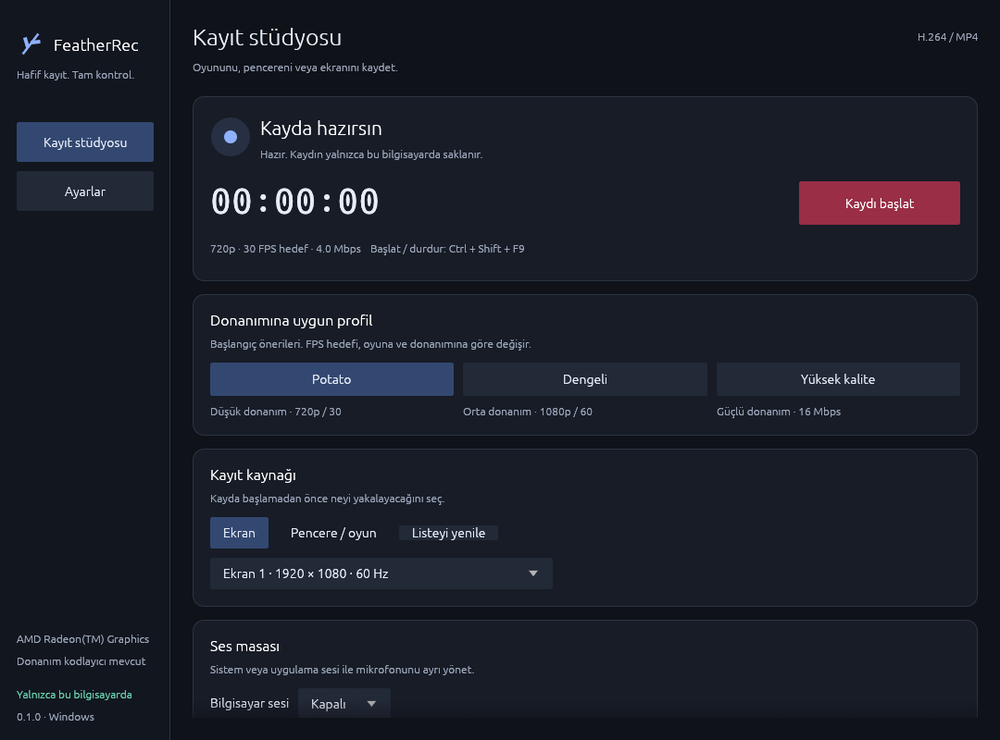

# FeatherRec


A focused Windows screen recorder written in Rust. Local H.264/MP4 capture, a
small dark desktop UI, and bounded GPU frame ownership. No preview, browser runtime,
accounts, advertisements, analytics, or cloud processing.

**Status: experimental desktop recorder with audio.** This is an initial functional
milestone, not a production-ready OBS replacement. There are no OBS comparison
results and no claim that FeatherRec is faster or uses fewer resources than OBS.

**Maintenance: community contributions and forks are welcome.** The original author
is not planning further updates. No maintainer response, fixes, security patches or
future releases are guaranteed. The source, build instructions and tests remain
available for anyone who wants to continue development under the MIT license.

[Download the latest published Windows build](https://github.com/boranseasonnew/featherrec/releases/tag/v0.1.0).



## Implemented

- Monitor or selected window/game capture through Windows Graphics Capture.
- Capture indicator disabled by default on supported Windows builds.
- Start/stop and normal application-close finalization on a background worker.
- 1280×720 or 1920×1080 output, 30/60 FPS capture pacing, adjustable H.264 bitrate.
- Six profiles, from Compact (720p30/2.5 Mbps) and Potato (720p30/4 Mbps)
  to Balanced (1080p60/8 Mbps) and Quality (1080p60/16 Mbps).
  Resolution, FPS, bitrate, output folder and cursor remain customizable.
- Actual hardware H.264 transform enumeration and inspection of the selected encoder.
  Hardware is required by default; allowing an unidentified/software encoder is explicit.
- Four reusable source-sized GPU textures by default (advanced: 3–8); bounded queue and nonblocking backpressure
  drops. No application GPU-to-CPU pixel readbacks in the recording loop.
- Local timer, submission count, dropped frames, submission latency, CPU, working set,
  output bytes and texture high-water diagnostics. Sustained pressure prompts a safer
  setting suggestion; it never silently changes quality.
- MP4 finalization followed by reopen, dimension check and first-frame decode.
  Failed recordings retain `.partial.mp4` instead of being reported as successful.
- Local recording JSON reports, optional portable preferences, folder picker and
  open-recordings-folder action.
- GUI and scriptable CLI, Windows CI, full-file validation and benchmark procedures.
- Turkish recording dashboard and dedicated General, Recording, Audio, Shortcuts
  and Advanced settings. Advanced controls require an explicit unlock.
- Assignable global start/stop, stop-only and microphone-mute shortcuts, with conflict
  detection. Defaults: Ctrl+Shift+F9, Ctrl+Shift+F10 and Ctrl+Shift+M.
- WASAPI system loopback or process-tree-only audio, plus a separate microphone.
  Endpoint selectors, live gain and microphone mute; one mixed stereo AAC track.
  Audio and microphone are off by default.

## Requirements

- Windows 10 version 1903 or later, or Windows 11, x64, with an interactive desktop.
  Process-only audio and capture-border control require build 20348 or newer.
- D3D11 feature level 11.0 or newer, working graphics driver, and Media Foundation.
  Windows N editions need the Media Feature Pack.
- Hardware H.264 support must be available through a registered Media Foundation
  transform. A GPU vendor name alone is not proof of support.
- Enough local storage; 4 Mbps is approximately 30 MB/minute before container overhead,
  but variable-rate content and encoder rate control affect real file size.
- The MSVC runtime is statically linked; no separate Visual C++ runtime installation
  or bundled FFmpeg executable is needed.

Windows 10, NVIDIA, Intel, multiple physical monitors and different drivers require
additional hardware validation. See [validation notes](docs/validation.md) for actual
tests and the distinction between platform targets and verified configurations.

## Build and run

Install stable Rust with the MSVC x64 target and Visual Studio Build Tools with
**Desktop development with C++**, the x64 toolset and Windows 10/11 SDK. Rustup
selects the pinned toolchain from `rust-toolchain.toml`. Use a Developer PowerShell.

```powershell
git clone https://github.com/boranseasonnew/featherrec.git
cd featherrec
cargo build --workspace --release --locked
./target/release/featherrec.exe
```

This builds `featherrec.exe` (GUI) and `featherrec-cli.exe` (console). They do not
need FFmpeg at runtime. `scripts/package.ps1` copies the binaries, documentation,
license and SHA-256 checksums into `target/portable`; it does not publish a release.
Unverified official binary releases are not published automatically.

On a machine with installed MSVC/SDK libraries but incomplete Visual Studio
registration, `scripts/dev.ps1` can use Rust's bundled linker:

```powershell
./scripts/dev.ps1 -CargoArgs @('build', '--workspace', '--release', '--locked')
```

An optional project-local Rust installation in `.tools` is detected by that helper.
The tools and downloaded dependencies are excluded from Git.

## Record

Choose a display or window and preset, adjust the settings, then select **Kaydı başlat**.
Select **Kaydı durdur** and wait for MP4 verification before moving the file.
Closing the window while recording requests stop and waits for finalization.
Portable preferences are saved beside the executable only when **Ayarları kaydet**
is selected. An unwritable folder produces an error.

In **Ayarlar → Ses**, choose system sound or only the selected application's sound.
Select a window first for application-only audio. It includes the application's child
processes, and never silently falls back to capturing all system audio. Add a microphone
only if wanted; choose its endpoint, level and mute independently. Levels and mute
can change during recording. Device/source changes apply to the next recording.

Audio is mixed locally into one 48 kHz stereo AAC track, rather than multiple independent
OBS tracks. Recording uses a temporary PCM file (about 11.5 MB/minute, maximum 4 GiB),
then a final audio encoding/mux pass without re-encoding H.264 video. Wait for completion.
Successful validation removes the temporary files; failures retain them for recovery.

CLI examples:

```powershell
./target/release/featherrec-cli.exe --diagnose
./target/release/featherrec-cli.exe --audio-devices
./target/release/featherrec-cli.exe --record --seconds 10 --output recordings
./target/release/featherrec-cli.exe --record --seconds 60 --preset balanced --fps 30 --monitor 1
./target/release/featherrec-cli.exe --record --seconds 10 --allow-software
./target/release/featherrec-cli.exe --record --seconds 10 --audio system --microphone
./target/release/featherrec-cli.exe --record --seconds 10 --window-title "My Game" --audio application
```

Options are applied left-to-right: put custom overrides after `--preset`. Bitrate is
in bits/second. Use `--help` for all arguments. Ctrl+C stops and finalizes safely;
forced process termination may leave an incomplete MP4.

## Recording behavior and limitations

- 30/60 FPS are capture ceilings, not performance guarantees. Static content may
  produce fewer callbacks. Reports distinguish input submissions from encoded output;
  verify actual output frame rate with the full-file test procedure.
- Changing source dimensions ends recording with an error. Closing a selected window
  ends capture and attempts normal finalization. Reselect before a new recording.
- WGC uses the default D3D adapter. Cross-adapter monitors, RDP sessions, screen lock,
  HDR, protected content and driver resets are not fully validated. Protected content
  can appear black. There is no HDR color-management implementation.
- Output scales the source to the selected 16:9 dimensions; other aspect ratios may
  stretch. There is no region capture or live preview. Window capture uses WGC,
  rather than an injected game hook; protected/exclusive-fullscreen games may fail
  or appear black. Try borderless window mode.
- Media Foundation performs format conversion/scaling. Availability and performance
  depend on Windows transforms and drivers. Direct AMF, NVENC and Quick Sync SDK
  integrations are not included; installed vendor Media Foundation encoders are used.
- Hardware policy fails conservatively when the selected encoder lacks the required
  hardware identification attribute, even if the underlying hardware might support it.
- The configured texture bound covers application frame ownership. Encoder/driver/OS/UI
  buffers are additional; the entire process is not limited to four textures' worth
  of memory. There is no claim of an end-to-end zero-copy driver pipeline.
- Submission time is measured; actual hardware encode latency, GPU usage and allocation
  counts are not yet instrumented. Dropped-frame counters cover application pool
  pressure, not every possible compositor/driver loss.
- Final verification decodes the first frame. It cannot prove every frame is valid.
  Full-file validation is a separate test. Disk-full, power loss and hung drivers
  can prevent finalization; recovery is not guaranteed.

## Tests and benchmarks

```powershell
cargo fmt --all --check
cargo clippy --workspace --all-targets --locked -- -D warnings
cargo test --workspace --locked
cargo build --workspace --release --locked
./tests/validate-recording.ps1 -Seconds 10 -Resolution 720 -Fps 30
```

The last command needs an interactive desktop and FFmpeg on PATH, records locally,
checks the texture limit and decodes the complete video. Repeat with moving content
and both output resolutions/FPS settings. Recordings in `validation/` are ignored by
Git and are never uploaded by the application. Reports contain local paths; review
them before sharing.

Hosted Windows CI runs formatting, lint, tests and release builds. It cannot prove
physical capture/encoding functionality. Read [architecture](docs/architecture.md)
for ownership and timing, [validation notes](docs/validation.md) for observed results,
and [the benchmark procedure](benchmarks/README.md) for a fair OBS comparison.

## Community development opportunities

These are open areas for contributors, not a release schedule or commitments from
the original author.

1. Expand real-driver testing across AMD, Intel and NVIDIA, Windows 10/11, multiple
   monitors, disconnects, resolution changes, full disks and longer sessions.
2. Measure dynamic-workload performance, allocations, GPU use and hardware latency;
   improve only against reproducible measurements.
3. Extend audio validation to long sessions, endpoint disconnects and additional
   drivers; consider independent tracks and streaming AAC to reduce temporary storage.
4. Preserve aspect ratio, add stronger session/driver recovery, and refine encoder
   diagnostics and independently verified software fallback.
5. Optional tray/history and better packaging. MKV only with a reliable muxer.
6. Expand the recording test matrix before publishing stable portable releases.

## Contribute and license

See [CONTRIBUTING.md](CONTRIBUTING.md) and [SECURITY.md](SECURITY.md).
FeatherRec is free and open source under the [MIT license](LICENSE).
